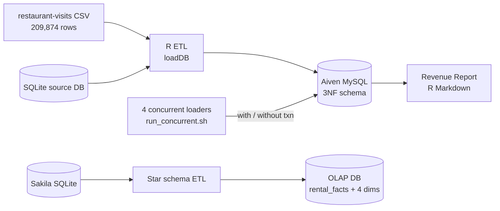
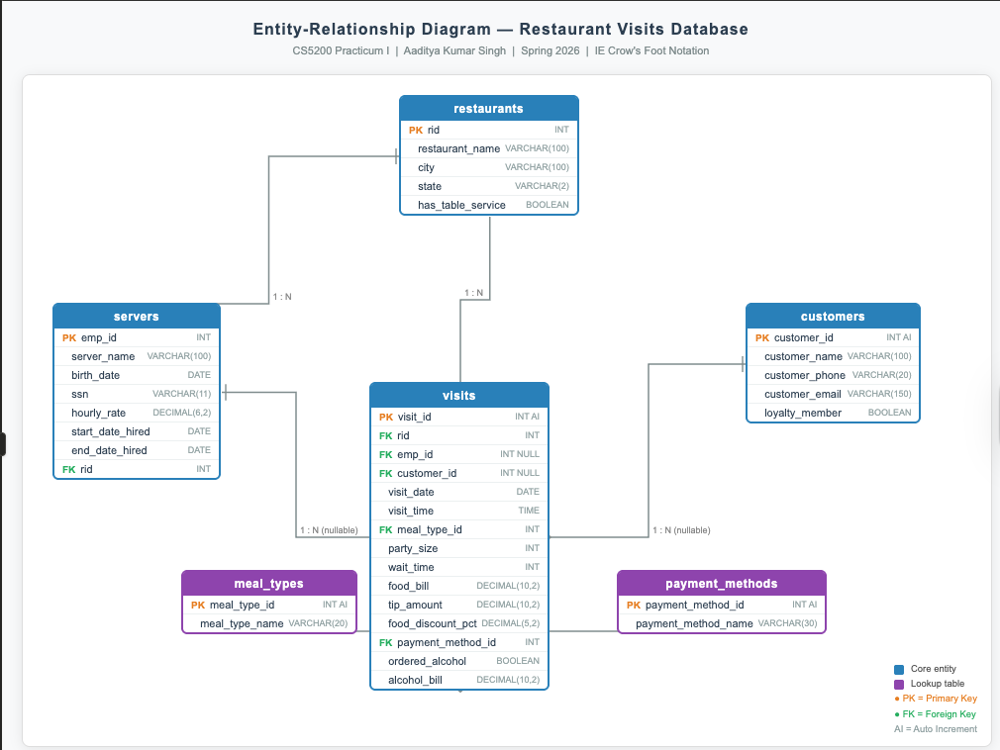

# Restaurant Analytics Database

**Normalized OLTP design, cloud MySQL ETL, concurrency-safe transactions, and a star-schema warehouse**


-4479A1?style=flat-square&logo=mysql&logoColor=white)


An end-to-end database project: decompose a flat dump of **209,874 restaurant visits** into a 3NF relational schema, load it into a TLS-secured **MySQL database on Aiven Cloud**, build revenue analytics on top, prove why transactions matter under **concurrent writes**, and model a **star schema** for OLAP on the Sakila dataset.

Built for CS5200 Database Management Systems, Northeastern University, Spring 2026.

---

## Architecture



## 1. Schema design and normalization

`designDBSchema.PractI.SinghA.Rmd`

- Identified functional dependencies in the raw visit data and decomposed it into **Third Normal Form**
- Six tables, created in dependency order: `restaurants`, `servers`, `customers`, `meal_types`, `payment_methods`, `visits`
- Entity descriptions and cardinalities documented alongside the ERD



## 2. ETL into cloud MySQL

`createDB` → `loadDB` → `configBusinessLogic` → `testDBLoading`

- Creates the schema on an Aiven-hosted MySQL (InnoDB) instance over TLS
- Loads all 209,874 visits from the CSV and SQLite sources into the normalized tables
- `testDBLoading` validates the load; `deleteDB` tears everything down for a clean rerun

## 3. Revenue analytics

`RevenueReport.PractI.SinghA.Rmd` queries the cloud database directly:

- **Per restaurant:** total visits, unique customers, loyalty-program visits, and total spend
- **Revenue by year:** the 3 most recent years, found dynamically with no hard-coded dates
- **Florida monthly trend:** average monthly revenue across the 2 most recent years, as a labeled line chart
- Revenue is defined as discounted food plus alcohol, with tips excluded

## 4. Concurrency and transactions

`SinghA.CS5200.Txn.R`, `run_concurrent.sh`, `observations.md`

Four loaders write to the live database at the same time (500 rows each, with a 0.05 s delay per insert to widen the race window), once with `START TRANSACTION / COMMIT` and once with `--no-txn`.

| | With transactions | Without transactions |
|---|---|---|
| Rows inserted | All 2,000 | All 2,000 |
| Duplicate customers | None | **Yes:** read-then-write race on email lookup |
| Mid-load failure | Clean **ROLLBACK**, database consistent | **Partial insert** left behind, no automatic recovery |

**Takeaway:** atomicity and isolation (InnoDB row-level locking and MVCC) are what prevent silent integrity bugs under concurrent writes.

## 5. Star-schema data warehouse

`CS5200.SinghA.DWA.Rmd`

- Transforms the Sakila OLTP database into a star schema: fact table `rental_facts` with `dim_time`, `dim_store`, `dim_category`, and `dim_staff`
- OLAP queries: monthly rental revenue across stores, revenue by film category, and staff performance comparison
- Covers when OLAP can live in a transactional database, and why a relational star schema over NoSQL for analytical queries

## Running it

**Requirements:** R with `DBI`, `RMariaDB`, and `RSQLite`, plus an Aiven MySQL instance

```bash
# 1. Credentials (never committed)
cp .Renviron.example .Renviron     # fill in your Aiven host, user, password
# download ca.pem from the Aiven console into the project root

# 2. Build and load
Rscript createDB.PractI.SinghA.R
Rscript loadDB.PractI.SinghA.R
Rscript configBusinessLogic.PractI.SinghA.R
Rscript testDBLoading.PractI.SinghA.R

# 3. Concurrency experiment
chmod +x run_concurrent.sh
./run_concurrent.sh            # with transactions
./run_concurrent.sh --no-txn   # without transactions
```

Knit `RevenueReport.PractI.SinghA.Rmd` and `CS5200.SinghA.DWA.Rmd` in RStudio for the reports.

## Repository structure

```
├── designDBSchema.PractI.SinghA.Rmd    # FDs, 3NF decomposition, ERD
├── createDB / loadDB / deleteDB        # Schema creation, ETL, teardown
├── configBusinessLogic / testDBLoading # Business logic setup, load validation
├── RevenueReport.PractI.SinghA.Rmd     # Revenue analytics
├── SinghA.CS5200.Txn.R                 # Transactional CSV loader
├── run_concurrent.sh                   # 4 parallel loaders
├── observations.md                     # Concurrency experiment results
├── CS5200.SinghA.DWA.Rmd               # Sakila star schema + OLAP
├── csv_data/                           # Synthetic concurrency test data
└── .Renviron.example                   # Credential template
```
